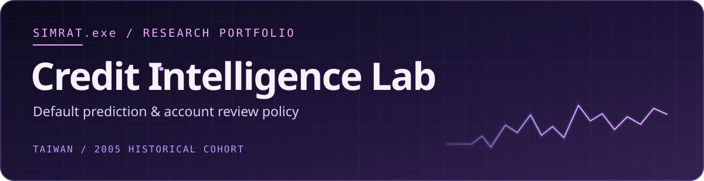
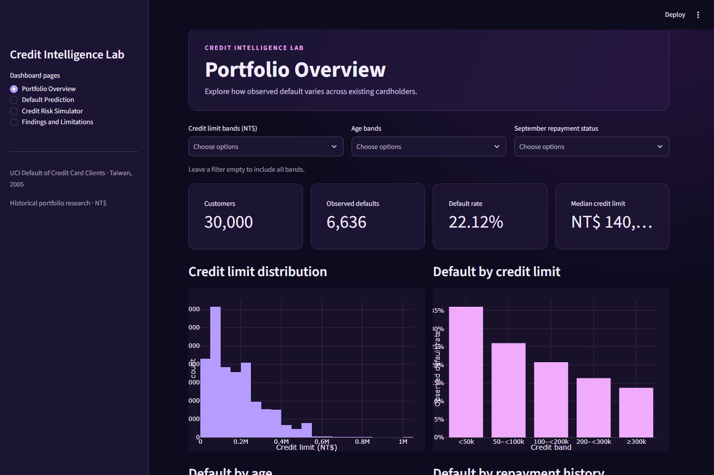
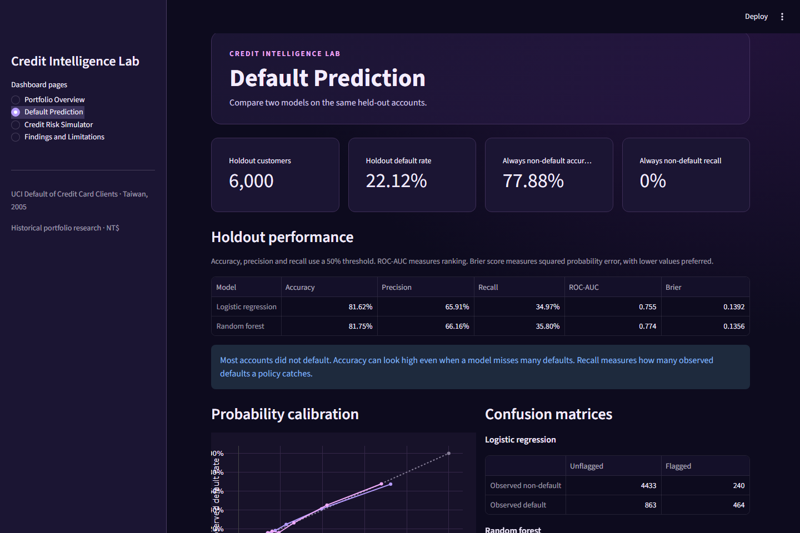
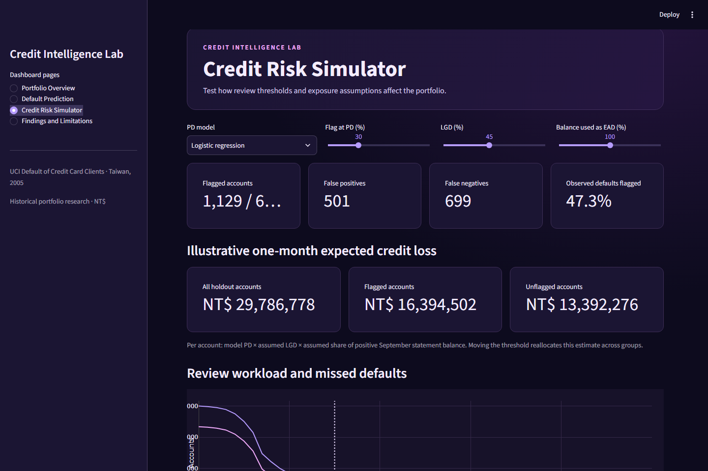
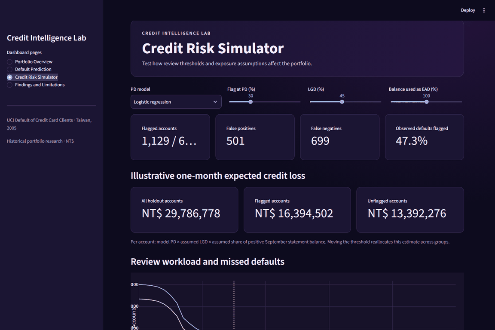
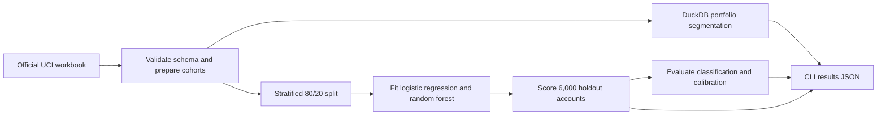
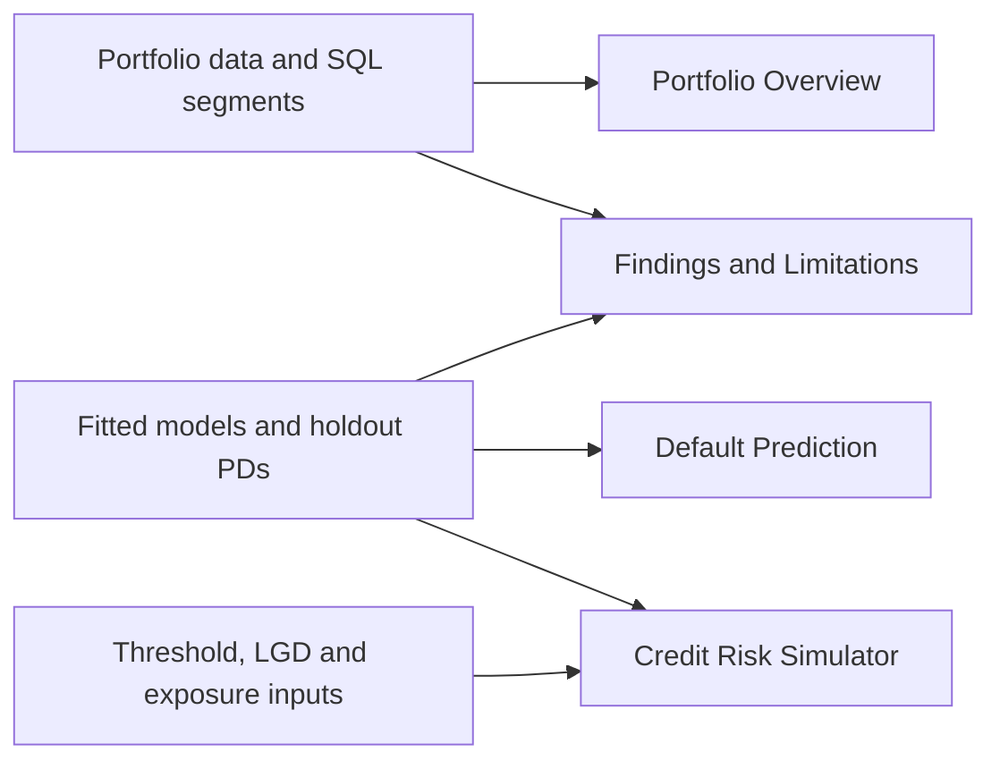

<p align="center">
  
</p>

<p align="center"><strong>Turn next-month default probabilities into an account-review policy that makes workload and financial exposure visible.</strong></p>

<p align="center">
  
</p>

<p align="center">
  
  
  
  
  
  
</p>

<p align="center">
  <a href="#dashboard-preview">Dashboard</a> ·
  <a href="#analytical-methodology">Methods</a> ·
  <a href="#architecture-and-data-pipeline">Pipeline</a> ·
  <a href="#key-empirical-findings">Results</a> ·
  <a href="#installation-and-reproduction">Run locally</a> ·
  <a href="#author-and-contact">Author</a>
</p>

## Dashboard preview

[](assets/portfolio-overview.png)

| Default Prediction | Credit Risk Simulator |
|---|---|
| [](assets/default-prediction.png) | [](assets/credit-risk-simulator.png) |

[Findings and Limitations screenshot](assets/findings-and-limitations.png) · [Launch the local demo](#installation-and-reproduction) · [Three-minute walkthrough](INTERVIEW_PREP.md#three-minute-demonstration)

<details>
<summary>Watch the threshold demo</summary>



</details>

## Executive summary

| Historical portfolio | Model comparison | Policy experiment |
|---|---|---|
| **30,000** cardholders<br>**22.12%** observed default rate | **0.755** logistic ROC-AUC<br>**0.774** forest ROC-AUC | **148** additional defaults captured<br>**543** additional reviews at a 20% vs. 30% logistic cutoff |

The 50% classification cutoff catches roughly 35% of observed defaults with either model. For an account-review team, the operational question is how many additional reviews it can handle and how much modeled exposure those reviews cover. The simulator makes both quantities visible on the same holdout.

## Research question and business context

> How can financial institutions balance credit default risk and expected financial losses when designing credit-risk policies?

An issuer monitoring existing accounts has limited review capacity. A low cutoff can surface more risky accounts while increasing workload and customer friction. Probability estimates help rank accounts, while exposure and loss severity show how much financial risk each flagged account represents. The prototype compares those trade-offs for account monitoring.

## Dataset and data preparation

I-Cheng Yeh’s **Default of Credit Card Clients** dataset covers 30,000 existing cardholders in Taiwan. Inputs span **April–September 2005** and the label records default the following month. Monetary values are in New Taiwan dollars (NT$). The source is released under CC BY 4.0. [UCI dataset, codebook and license](https://doi.org/10.24432/C55S3H)

1. Read the official workbook and verify the shape, schema, unique customer IDs, missing values and binary target. The pipeline retains all 30,000 observations.
2. Reproduce five credit-limit bands from the original [exploration notebook](notebooks/01_exploration.ipynb). Add age and September delay bands for descriptive analysis.
3. Aggregate account counts, observed defaults, rates and median limits by credit band and September repayment status with [DuckDB SQL](sql/portfolio_segments.sql).
4. Build the model inputs from 19 pre-outcome variables covering credit limit, repayment status, bill amounts and payment amounts. ID and demographic fields are excluded from model features.

The observed rate in segment $g$ is the mean of its binary outcomes.

$$
\widehat r_g = \frac{1}{n_g}\sum_{i \in g} y_i, \qquad y_i \in \{0,1\}
$$

## Analytical methodology

**Evaluation design.** Both models use the same stratified 80/20 split, with 24,000 training accounts, 6,000 held-out accounts and seed 42. Scaling and encoding are fitted on the training rows inside the logistic pipeline.

| Method | Implementation | What it reveals |
|---|---|---|
| Logistic regression | L2-regularized model with standardized monetary inputs and one-hot repayment codes | Signed coefficients show conditional changes in log-odds. |
| Random forest | 160 trees, maximum depth 10, minimum leaf size 20 | Captures nonlinear patterns and interactions. Impurity importance summarizes split contributions. |
| Holdout evaluation | Confusion matrices, accuracy, precision and recall at a 50% cutoff, plus ROC-AUC and Brier score | Separates threshold behavior, ranking and probability error. |
| Calibration | Compare mean predicted PD and observed default rates in up to ten equal-frequency groups | Shows where raw probabilities overstate or understate observed risk. |

Logistic regression maps the linear score to a next-month probability. The simulator flags accounts when their PD reaches cutoff $t$ and calculates illustrative expected credit loss (ECL).

$$
p_i = \frac{1}{1 + e^{-(\beta_0 + x_i^\top\beta)}}
\qquad \operatorname{flag}_i(t)=\mathbf{1}[p_i \ge t]
$$

$$
\operatorname{ECL}_i = p_i \times \operatorname{LGD} \times \operatorname{EAD}_i,
\qquad \operatorname{EAD}_i = s \times \max(0,\operatorname{SeptemberBill}_i)
$$

LGD is the assumed fraction lost if default occurs. The slider $s$ scales the positive September statement balance used as the exposure proxy. See the [Learning Guide](LEARNING_GUIDE.md) for worked examples and the interpretation of model coefficients.

## Architecture and data pipeline





## Key empirical findings

**Recent delinquency separated observed risk.** Default rates were **13.83%** for 23,182 accounts with no positive September delay code, **33.95%** for 3,688 accounts one month late, and **69.55%** for 3,130 accounts at least two months late. Default also declined across credit-limit bands, from **36.07%** below NT$50,000 to **13.68%** at NT$300,000 or above. Both comparisons are descriptive.

| Model | Accuracy | Precision | Recall | ROC-AUC | Brier ↓ |
|---|---:|---:|---:|---:|---:|
| Logistic regression | 81.62% | 65.91% | 34.97% | 0.755 | 0.1392 |
| Random forest | 81.75% | 66.16% | 35.80% | 0.774 | 0.1356 |

Always predicting non-default yields **77.88% accuracy** and **zero recall**. The random forest had better ranking and lower probability error on this split. The logistic model provides signed coefficients for explaining the model’s drivers.

| Logistic review cutoff | Flagged | Defaults caught | False positives | Defaults missed | Flagged ECL |
|---|---:|---:|---:|---:|---:|
| 30% | 1,129 | 628 | 501 | 699 | NT$16.39m |
| 20% | 1,672 | 776 | 896 | 551 | NT$17.65m |

At 45% assumed LGD and 100% of positive September balances as EAD, total holdout ECL is **NT$29.79m** under both thresholds. The cutoff changes which accounts carry the modeled loss inside the review queue.

## Interactive dashboard features

| Page | What to explore |
|---|---|
| **Portfolio Overview** | Filter by credit limit, age and repayment status. Read cohort KPIs, distributions, default-rate charts and the DuckDB segment table. |
| **Default Prediction** | Compare headline metrics, confusion matrices and calibration. Toggle between logistic coefficients and forest feature importance. |
| **Credit Risk Simulator** | Change the PD cutoff, LGD and exposure assumptions. Trace flags, false positives, missed defaults and ECL. |
| **Findings and Limitations** | Interpret the observed relationships and assess their scope for policy, fairness and new-loan decisions. |

## Business implications and strategic recommendations

- **Size the review queue before selecting a cutoff.** In the historical simulation, moving from 30% to 20% adds 543 reviews and catches 148 additional defaults, about 27% of the incremental queue. Compare that yield with available staff time and customer friction.
- **Compare queue volume and financial exposure.** Accounts with similar PDs can carry different exposures. Flagged ECL describes risk in the queue. A business case for intervention also requires review costs and evidence on preventable loss.
- **Validate policy on a later cohort.** Select the cutoff using a validation cohort and a review-capacity constraint. Measure ranking, calibration and subgroup errors on a separate later-period test set before considering operational use.

## Limitations and future research

- **Causality.** Existing credit limits reflect earlier underwriting and customer circumstances. Estimating the effect of changing a limit or reaching out to a customer requires intervention evidence.
- **New-loan approval.** The sample contains established accounts from one historical period. New applicants may lack this account history, and outcomes for previously rejected applicants are unobserved.
- **Fairness.** Demographic inputs were omitted from prediction. Financial variables may still act as proxies. A representative audit should assess subgroup calibration, error rates and sample sizes.
- **Loss estimates and drift.** Realized recoveries and exposure at default are unavailable. Obtain those outcomes and validate raw probabilities across later cohorts before relying on the estimates.

## Repository structure

```text
.
├── app.py                       Streamlit navigation and theme
├── .streamlit/config.toml         Cyber Lavender configuration
├── assets/                       Banner, screenshots, demo GIF and footer
├── notebooks/01_exploration.ipynb  Original exploration
├── sql/portfolio_segments.sql     DuckDB portfolio query
├── src/
│   ├── data.py                   Acquisition, validation and segmentation
│   ├── modeling.py               Models, metrics and loss calculation
│   ├── dashboard.py              Interactive charts and controls
│   └── pipeline.py               Reproducible command-line analysis
├── requirements.txt
├── LEARNING_GUIDE.md
└── INTERVIEW_PREP.md
```

## Installation and reproduction

Use Python 3.11. From the project directory in Windows PowerShell:

```powershell
python -m venv .venv
.venv\Scripts\python.exe -m pip install -r requirements.txt
.venv\Scripts\python.exe -m src.pipeline
.venv\Scripts\python.exe -m streamlit run app.py
```

On macOS or Linux, replace `.venv\Scripts\python.exe` with `.venv/bin/python`. With Streamlit running, open [localhost:8501](http://localhost:8501) for the interactive demo. The first run downloads the source workbook into a local archive cache. The pipeline writes `data/results.json` with the reproducible numbers above. The dashboard can also run directly without creating that report.

To run offline after dependency installation, save the official archive as `data/uci_credit_cards.zip`. To rerun the original notebook independently, use a Jupyter environment with `requests` and `matplotlib`. [Official UCI archive](https://archive.ics.uci.edu/static/public/350/default+of+credit+card+clients.zip)

## Author and contact

**Simrat Khalsa · SIMRAT.exe**  
MSc Economics and Data Science student. Connect through [GitHub @simrat28701](https://github.com/simrat28701).

**AI-assisted development.** I wanted to explore the research question of how financial institutions would be able to balance financial risk, with the assistance of AI, I was able to create such an advanced dashboard so quickly. I plan to use these data findings to explore and attampt to answer my question.

<p align="center">
  <a href="https://github.com/simrat28701"></a>
</p>
